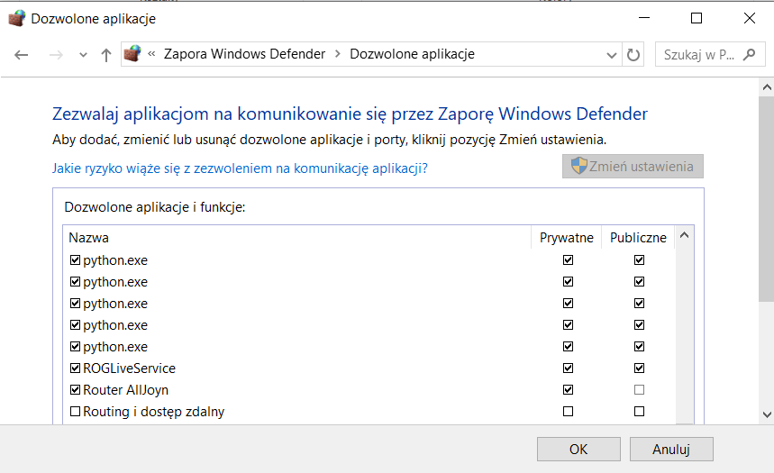
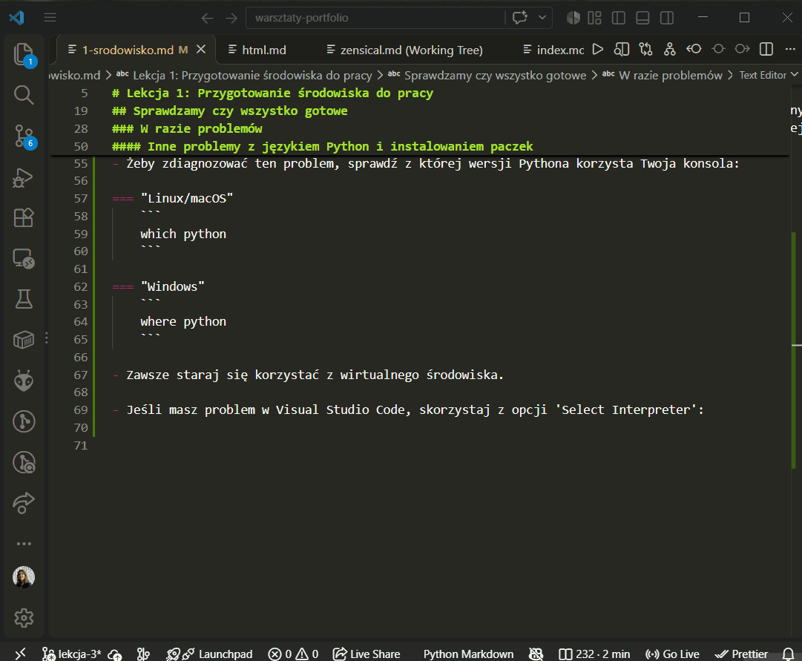

[git]: https://git-scm.com/
[python]: https://www.python.org/
[vscode]: https://code.visualstudio.com/

# Lekcja 1: Przygotowanie środowiska do pracy

## Instalujemy potrzebne narzędzia

- [git] - Najpopularniejszy system kontroli wersji (dowiemy się o tym więcej na kolejnych zajęciach). Zobacz też: [git w 5 minut](referencje/git.md)
- [python] - Język programowania potrzebny do generatora Pelican. Łatwy język na początek przygody z programowaniem.
- [Visual Studio Code][vscode] - Edytor kodu, który znacznie ułatwi nam pracę nad projektem. Zobacz też: [Visual Studio Code w 5 minut](referencje/vscode.md)

## Tworzymy nowy projekt

Skrót klawiszowy do otworzenia konsoli w Visual Studio Code: ++ctrl+grave++


## Sprawdzamy czy wszystko gotowe

Wpisz poniższe komendy w konsoli i sprawdź czy masz podobny wynik (wersja może być inna):

komenda | wynik
--- | ---
`git version` | `git version 2.45.1.windows.1`
`python --version` | `Python 3.14.3`

### W razie problemów

Windows potrafi zablokować wykonywanie niektórych komend, szczególnie związanych z językiem Python. 
Oto rozwiązania na potencjalne problemy, które mogą się pojawić.

#### Nie można aktywować wirtualnego środowiska `cannot be loaded because the execution of scripts is disabled on this system`

```
Set-ExecutionPolicy Unrestricted -Scope Process
```

#### Windows Defender blokuje instalowanie paczek Python

Przykładowa komenda, przy której może pojawić się ten problem:
```
python -m pip install "pelican[markdown]"
```

Zezwól aplikacji python na komunikowanie się przez zaporę Windows:



#### Inne problemy z językiem Python i instalowaniem paczek

Przy pracy z Pythonem może zdarzyć się, że zainstalujesz kilka różnych wersji tego języka w różnych miejscach w swoim lokalnym środowisku.
Czasem zdarza się, że dana konsola lub program korzystają z innej wersji Pythona niż ta, w której masz zainstalowane paczki.

- Żeby zdiagnozować ten problem, sprawdź z której wersji Pythona korzysta Twoja konsola:

=== "Linux/macOS"
    ```
    which python
    ```

=== "Windows"
    ```
    where python
    ```

- Zawsze staraj się korzystać z wirtualnego środowiska.

- Jeśli masz problem w Visual Studio Code, skorzystaj z opcji 'Select Interpreter':



