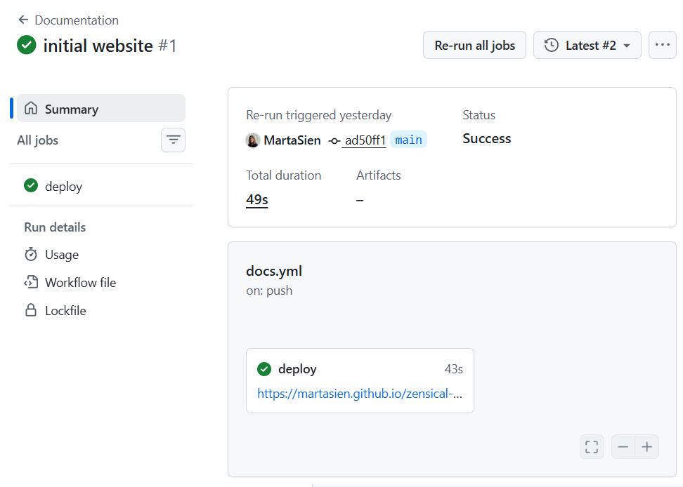

# Lekcja 3: Publikacja strony na GitHub

## Zakładamy konto na GitHub

GitHub to platforma internetowa, która pozwala na przechowywanie i publikację repozytoriów. Wspiera system kontroli wersji git. 
Umożliwia także hosting statycznych stron internetowych, z którego skorzystamy by opublikować stronę stworzoną w Zensical.

- [github](https://github.com/)

- założenie konta na GitHub jest darmowe, z płatnymi wariantami subskrypcji (GitHub Pro)
- na nasze potrzeby, wystarczy konto darmowe (GitHub Free)

### Przydatna dokumentacja

- [start your journey](https://docs.github.com/en/get-started/start-your-journey)
- [github glossary](https://docs.github.com/en/get-started/learning-about-github/github-glossary)

## Tworzymy nowe repozytorium

- [github.com/new](https://github.com/new)

1. Wybierz dowolną nazwę 
1. W opcji `visibility` wybierz `Public`. 
1. Pozostałe ustawienia zostaw domyślne.

## GitHub Pages w naszym repozytorium

By opublikować naszą stronę musimy włączyć opcję GitHub Pages w ustawieniach naszego repozytorium.

1. Przejdź do ustawień (Settings) swojego repozytorium
1. Wybierz sekcję "Code, planning, and automation"->"Pages"
1. W sekcji "Build and deployment" wybierz "GitHub Actions"

Gotowe! Gdy 

## Przygotowanie i publikacja strony

Jeśli chcesz opublikować swoje istniejące repo stworzone na poprzednich zajęciach, przejdź do Opcji 1. 
Jeśli chcesz stworzych nową stronę, przejdź do Opcji 2.

### Opcja 1: Publikacja istniejącego repo

korzystaj z wygenerowanych przez GitHub komend 
w sekcji `…or push an existing repository from the command line`: 

```
git remote add origin https://github.com/MartaSien/zensical-test-website.git
git branch -M main
git push -u origin main
```

### Opcja 2: Stworzenie nowej strony od zera

Teraz przygotujemy przykładową stronę w Zensical, którą potem opublikujemy w naszym repozytorium.

1. Klonujemy stworzone przed chwilą repozytorium GitHub i otwieramy je.

```sh
git clone https://github.com/MartaSien/zensical-test-website.git
```

W odpowiedzi możecie dostać `warning: You appear to have cloned an empty repository.` - to jest okej.

1. Instalujemy Zensical
- [zensical - get-started](https://zensical.org/docs/get-started/)

=== "Windows"
    ```sh
    python -m venv .venv  
    .venv\Scripts\activate
    pip install zensical
    ```
=== "macOS/Linux"
    ```sh
    python3 -m venv .venv
    source .venv/bin/activate
    pip install zensical
    ```

W razie problemów z wykonaniem tych komend, 

1. Tworzymy nową stronę

```sh
zensical new .
```
1. Tworzymy commit z nową stroną

```sh
git stage .
git commit -m "Initial website"
```

1. Publikujemy stronę

```sh
git push -u origin main
```

W tym momencie może być konieczność zalogowania się do GitHub.
Podaj nazwę użytkownika. Zamiast hasła, wygenerujemy Personal Access Token (PAT). 
Nie publikuj go, traktuj go jak hasło!

- [GitHub Personal access tokens](https://github.com/settings/tokens)

```
Username for 'https://github.com': MartaSien 
Password for 'https://MartaSien@github.com': 
```

Tekst w polu `Password` jest ukryty.

Po udanym logowaniu, nasze zmiany powinny zostać opublikowane:

```
Enumerating objects: 9, done.
Counting objects: 100% (9/9), done.
Delta compression using up to 16 threads
Compressing objects: 100% (7/7), done.
Writing objects: 100% (9/9), 4.00 KiB | 1023.00 KiB/s, done.
Total 9 (delta 0), reused 0 (delta 0), pack-reused 0 (from 0)
To https://github.com/MartaSien/zensical-test-website.git
 * [new branch]      main -> main
branch 'main' set up to track 'origin/main'.
```

Sprawdźmy czy pierwsza akcja się wykonała i udało się nam opublikować stronę:

- [zensical-test-website/actions](https://github.com/MartaSien/zensical-test-website/actions)

Tak wygląda akcja wykonana z sukcesem. 😊
Nasza strona powinna być dostępna pod wygenerowanym linkiem: https://martasien.github.io/zensical-test-website/

